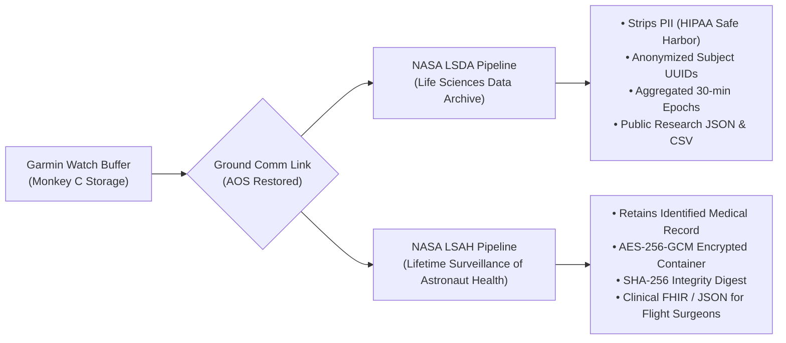

# DAQQA (دِقَّة) | Autonomous Astronaut Health Monitoring & Garmin Telemetry

> **2026 NASA Space Apps Challenge** — **Software for Healthcare Track**  
> Space Health Monitoring & Wearable Biometrics for Long-Duration Exploration (Artemis & Mars Missions)


---

## 🛰️ Project Overview

**DAQQA** (Arabic: *دِقَّة* — meaning *Precision, Accuracy, and Heartbeat*) is an integrated astronaut healthcare ecosystem designed to address the challenges of monitoring human physiology during long-duration spaceflight.

During deep space missions (such as lunar far-side sorties or Mars transit), continuous telemetry to Earth is impossible due to **communication blackouts (Loss of Signal / LOS)** and interplanetary transit latencies. DAQQA operates autonomously on the astronaut's wrist via **Garmin smartwatches (Connect IQ / Monkey C)**, providing real-time physiological vigilance and haptic alarming, before syncing via a **Dual-Export Architecture** to NASA archives once ground network connectivity is re-established.

---

## 🎯 Core Capabilities

### 1. Continuous Biometrics
- **Sensors**: Real-time passive tracking via Garmin Elevate™ optical PPG and Pulse Ox sensor suites.
- **Parameters**:
  - Heart Rate (HR in BPM)
  - Heart Rate Variability (HRV in RMSSD ms)
  - Blood Oxygen Saturation ($\text{SpO}_2$ in %)
  - Autonomic Stress Index ($1 - 100$)
  - Microgravity Physical / Muscle Fatigue Index ($0 - 100\%$)
- **High-Fidelity Telemetry**: 60 FPS Lead II Plethysmograph / ECG waveform visualization synchronized with cardiac pacing.

### 2. Behavioral Integration (On-Wrist Task UI)
- Delivers subjective questionnaires directly on the Garmin AMOLED display:
  - **Morning Sleep Quality Survey**: Sleep latency, night awakenings, subjective restedness ($1-5$).
  - **POMS Psychological & Stress Check**: Cognitive focus, fatigue level, anxiety, and crew morale ($1-5$).
- **Multi-Modal Synchronization**: Every behavioral submission is timestamped alongside concurrent physiological sensor streams, eliminating retrospection bias.

### 3. Autonomous Blackout Operations
- **Offline NVRAM Storage**: Uses `Toybox.Application.Storage` to locally serialize and cache continuous telemetry and survey records during deep space communication blackouts ($\text{LOS}$).
- **Instant Wrist Haptic & Audio Alarming**: Zero-latency on-device threshold detection triggers physical vibration patterns and screen warnings when critical limits are breached ($\text{SpO}_2 < 90\%$ or acute tachycardia), requiring zero Earth connectivity.

### 4. NASA Dual-Export Database Architecture
Once communication with Earth ground stations ($\text{AOS}$) is re-established, the **Dual-Export Dispatcher** automatically separates the cached payload into two distinct NASA pipelines:



---

## 🛠️ Tech Stack & Directory Structure

- **Wearable Device**: Garmin tactix 7 / fenix 7 / descent Mk3
- **SDK & Watch Runtime**: Garmin Connect IQ System 7 / Monkey C 4.2+
- **Mission Control Web App**: React 18, Vite, Tailwind CSS, Lucide Icons, Canvas 60fps ECG
- **Data Protocols**: NASA LSDA Research Schema & NASA LSAH Authenticated Encryption Format

```
DAQQA/
├── src/
│   ├── components/
│   │   ├── watch/             # Tactical Garmin watch chassis, AMOLED HUD, Task UI & alarms
│   │   ├── telemetry/         # Flight surgeon roster, 60fps ECG canvas, multi-channel charts
│   │   ├── export/            # NASA Dual-Export Hub (LSDA vs LSAH pipelines)
│   │   ├── monkeyc/           # Connect IQ Monkey C source suite & code viewer
│   │   └── layout/            # Mission header, MET clock, comm blackout toggle
│   ├── context/               # Mission state, crew roster, and sensor tick engine
│   └── utils/                 # Biometric synthesis, LSDA anonymizer, and LSAH crypto envelope
├── package.json
└── vite.config.js
```

---

## 🚀 Quickstart & Development

### Prerequisites
- [Node.js](https://nodejs.org/) (v18 or higher)
- [npm](https://www.npmjs.com/)

### Installation & Run
```bash
# Clone the repository
git clone https://github.com/<your-username>/DAQQA.git
cd DAQQA

# Install dependencies
npm install

# Start local telemetry server
npm run dev
```

Open [http://localhost:5173](http://localhost:5173) in your browser.

---

## 🧪 Mission Scenarios Included

Test how the Garmin watch and flight surgeon dashboard respond under different flight conditions:
1. **Nominal Orbital Routine**: Standard intra-vehicular baseline.
2. **High-Exertion EVA (Spacewalk)**: Elevated physical exertion and muscle fatigue ($76\%$).
3. **Deep Space Comm Blackout (LOS)**: Autonomous watch operation with local storage queueing.
4. **Acute Hypoxia / Micro-Decompression**: Sudden $\text{SpO}_2$ plunge to $86.5\%$ triggering immediate wrist alarms.
5. **Circadian Rhythm Desync & Fatigue**: Suppressed $\text{HRV}$ ($18 \text{ ms}$), high morning cortisol, and sleep fragmentation.

---

## 📜 Development Timeline
- **September 2026**: Initial spaceflight healthcare research, Garmin Connect IQ sensor API evaluation, and concept design.
- **November 2026**: System architecture formalization, offline storage buffering, and NASA LSDA / LSAH dual-export pipeline integration.

---

## 📄 License
This project is open-source under the [MIT License](LICENSE). Developed for the **2026 NASA Space Apps Challenge**.
